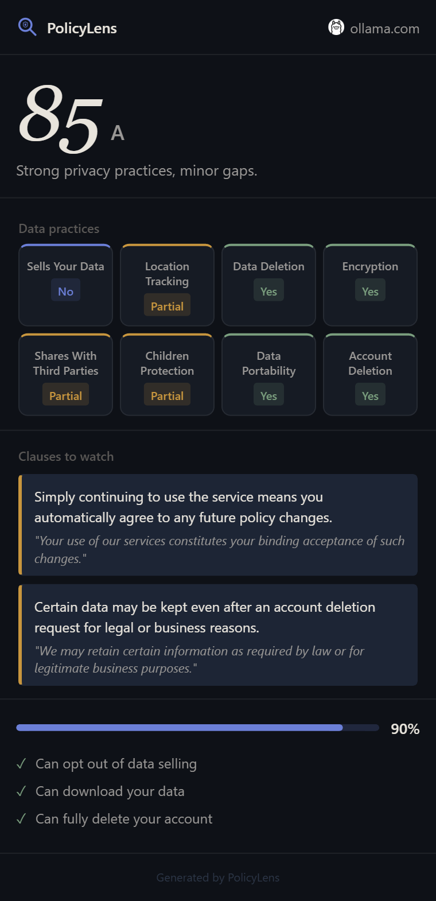

# PolicyLens 🔍

> **Instantly understand any website's privacy policy — no legal degree required.**

PolicyLens is a Chrome/Edge browser extension that automatically detects, fetches, and analyzes the privacy policy of any website you visit. It uses **Google Gemini AI** to classify risks, translate legal clauses into plain English, and display a visual privacy report card — with colored risk badges, an animated privacy score, plain-English summaries, and a one-click shareable PNG export.

---

## Screenshots

| Popup UI | Risk Badges | Your Rights |
|----------|-------------|-------------|
|  | .png) | — |

---

## How It Works

```
You visit a website
    └─► content.js scans page for privacy policy links
           └─► popup.js sends request to local Python backend
                  └─► 1. detector.py  — finds the policy URL
                      2. scraper.py   — fetches & cleans policy text
                      3. analyzer.py  — sends to Google Gemini AI
                              └─► if Gemini unavailable: heuristic fallback
                      4. main.py      — diffs against previous snapshot, saves to DB
                      5. popup.js     — renders score, badges, red flags, rights
```

---

## Features

- 🔎 **Automatic Policy Detection** — scans page links, scores by text/href patterns, falls back to common URL paths (`/privacy`, `/legal/privacy`, etc.)
- 🤖 **AI-Powered Analysis** — Google Gemini rates 8 privacy practice categories with colored YES/NO/PARTIAL badges
- 📊 **Privacy Score 0–100** — animated circular gauge with letter grade (A–F)
- 🚨 **Red Flag Clauses** — 3–5 verbatim quotes from the policy with plain-English translations + "Read in Policy" deep-link (Chrome Text Fragments)
- ⚖️ **User Rights & Autonomy Score** — tracks opt-out of data selling, data export, full account deletion
- 📅 **Policy Change Detection** — compares current policy text to previous snapshot; shows HTML diff when it changes
- 📸 **Share as Image** — exports the report as a PNG via html2canvas
- ⚡ **Offline Heuristic Fallback** — works without a Gemini API key using fast rule-based analysis
- 💾 **Local Caching** — caches results in `chrome.storage.local`; no repeat API calls for the same site
- ⚙️ **Configurable Backend URL** — settings modal lets you point to a custom backend

---

## Tech Stack

| Layer | Technology |
|-------|-----------|
| Extension UI | Vanilla JavaScript (ES2022), HTML, CSS |
| Extension Manifest | Chrome Manifest V3 |
| Image Export | html2canvas v1.4.1 |
| Policy Diff | diff-match-patch |
| Backend Framework | Python 3.11+ + FastAPI 0.115 |
| ASGI Server | Uvicorn 0.32 |
| HTTP Client | httpx 0.27 (async, anti-bot headers) |
| HTML Parsing | BeautifulSoup4 4.12 |
| AI Analysis | **Google Gemini** (gemini-1.5-flash primary → gemini-2.0-flash → gemini-1.5-flash-8b → gemini-1.5-pro) |
| Heuristic Fallback | Custom regex-based offline engine |
| Database | SQLite (auto-created) |
| ORM | SQLAlchemy 2.0 |
| Env Management | python-dotenv |

---

## AI Models Used

PolicyLens uses **Google Gemini** via the REST API (`generativelanguage.googleapis.com`) with automatic multi-model fallback:

| Priority | Model | Role |
|----------|-------|------|
| 1 | `gemini-1.5-flash` | Primary — fast and cost-effective |
| 2 | `gemini-2.0-flash` | Fallback if primary hits quota |
| 3 | `gemini-1.5-flash-8b` | Smaller fallback |
| 4 | `gemini-1.5-pro` | High-quality final fallback |
| 5 | Heuristic Engine | Offline fallback — no API key needed |

The primary model is configurable via the `GEMINI_MODEL` environment variable. If the API key is missing, invalid, or all models are exhausted, the extension seamlessly switches to the built-in heuristic analyzer — no crashes, no blank screens.

---

## Setup — Backend

### Prerequisites
- Python 3.11+
- A Google Gemini API key — [get one free at Google AI Studio](https://aistudio.google.com)

```bash
# 1. Clone the repository
git clone https://github.com/Akshayjankar/PolicyLens.git
cd PolicyLens

# 2. Create and activate a virtual environment
python -m venv .venv

# Windows
.venv\Scripts\activate

# macOS / Linux
source .venv/bin/activate

# 3. Install dependencies
cd backend
pip install -r requirements.txt

# 4. Configure environment variables
copy .env.example .env     # Windows
# or: cp .env.example .env # macOS/Linux

# Edit .env and set your Gemini API key:
# GEMINI_API_KEY=your_key_here

# 5. Start the backend server
python main.py
# → Server starts at http://localhost:8000
# → SQLite database (policylens.db) is created automatically
```

---

## Setup — Extension

```
1. Open Chrome and navigate to chrome://extensions
2. Enable "Developer Mode" (top-right toggle)
3. Click "Load unpacked"
4. Select the extension/ directory inside this repository
5. The PolicyLens icon (🔍) will appear in your Chrome toolbar
```

> The extension connects to `http://127.0.0.1:8000` by default. You can change this in the extension's Settings modal.

### One-time setup: icons & JS libraries

If icons or libraries are missing, run from the repo root:

```bash
# Generate PNG icons from the SVG source
python make_icons.py

# Or if you have Python with Pillow/cairosvg not installed, the icons
# are already included in extension/icons/
```

The `diff-match-patch.js` and `html2canvas.min.js` files are already bundled in `extension/libs/`.

---

## Environment Variables

| Variable | Description | Default |
|----------|-------------|---------|
| `GEMINI_API_KEY` | Google Gemini API key (from AI Studio) | *(required for AI analysis)* |
| `GEMINI_MODEL` | Primary Gemini model to use | `gemini-1.5-flash` |
| `DATABASE_URL` | SQLAlchemy connection string | `sqlite:///./policylens.db` |

> **No API key?** PolicyLens still works — it falls back to the built-in heuristic engine automatically.

---

## API Endpoints

### `POST /analyze`

Analyzes a website's privacy policy. Auto-detects the policy URL if not supplied.

**Request:**
```json
{
  "site_url": "https://instagram.com",
  "policy_url": null,
  "policy_text": null
}
```

**Response:**
```json
{
  "site_url": "https://instagram.com",
  "policy_url": "https://help.instagram.com/privacy/policy",
  "overall_score": 32,
  "grade": "F",
  "risk_badges": [
    {
      "category": "Sells Your Data",
      "verdict": "YES",
      "severity": "red",
      "plain_english": "Shares data with Meta affiliates and advertising partners."
    }
  ],
  "dangerous_clauses": [
    {
      "original": "We may share aggregate and de-identified information with our partners...",
      "plain_english": "They share your data with other companies, just without your name."
    }
  ],
  "negotiation_score": {
    "score": 42,
    "opt_out_data_selling": false,
    "download_your_data": true,
    "full_account_deletion": false,
    "summary": "You have 42% control over your data on this site."
  },
  "policy_changed": false,
  "previous_analysis_date": null,
  "diff_html": null,
  "snapshot_id": 1,
  "source": "gemini"
}
```

### `GET /history?site_url=https://instagram.com`

Returns all previous analysis snapshots for a site URL, ordered most-recent first.

### `GET /health`

Returns `{"status": "ok"}`. Used by the extension to verify the backend is running before each analysis.

---

## Privacy & Security

- The backend runs **entirely locally** on your machine — your browsing data never leaves your computer.
- Policy text is sent to the Google Gemini API for analysis. No other data is transmitted.
- Results are cached locally in `chrome.storage.local`. No tracking, no analytics.

---

## Project Structure

```
PolicyLens/
├── backend/
│   ├── main.py          # FastAPI app — routes, middleware, pipeline orchestration
│   ├── analyzer.py      # Gemini AI analysis + offline heuristic fallback
│   ├── detector.py      # Privacy policy URL detection (link scoring + path probing)
│   ├── scraper.py       # Policy page fetching with anti-bot mitigation
│   ├── prompts.py       # Gemini system prompt and JSON schema specification
│   ├── models.py        # SQLAlchemy ORM model (PolicySnapshot)
│   ├── schemas.py       # Pydantic request/response schemas
│   ├── database.py      # SQLite setup and session dependency
│   ├── requirements.txt
│   ├── .env.example
│   └── policylens.db    # Auto-generated SQLite database
├── extension/
│   ├── manifest.json    # Chrome MV3 manifest
│   ├── popup.html       # Extension popup shell
│   ├── popup.js         # Full UI logic (rendering, fetching, settings, export)
│   ├── popup.css        # Dark-theme stylesheet
│   ├── background.js    # Service worker (tab lifecycle, session storage)
│   ├── content.js       # Page-level privacy link detector
│   ├── icons/           # PNG icons (16, 32, 48, 128px)
│   └── libs/
│       ├── html2canvas.min.js    # Screenshot / share-as-image
│       └── diff-match-patch.js   # Policy text diff
├── make_icons.py        # Icon generation script
├── run_setup.py         # One-shot setup helper
└── README.md
```

---

## Contributing

Pull requests are welcome! For major changes, please open an issue first to discuss what you'd like to change.

---

## License

MIT License — see [LICENSE](LICENSE) for details.

---

*Built with ❤️ to make privacy policies readable for everyone.*
